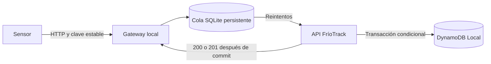

# Cómo usar y comprobar FríoTrack en tu computador

## Qué necesitas entender de DynamoDB y AWS

DynamoDB es el motor asignado. En AWS es un servicio administrado: las tablas viven en la nube y se accede mediante API, SDK o consola. DynamoDB Local implementa una versión para desarrollo que aquí corre en Docker, en http://127.0.0.1:8000. No necesitas cuenta, tarjeta ni credenciales reales de AWS. Las credenciales `localdemo` del código son ficticias y el cliente bloquea destinos remotos. No se ha desplegado AWS.

El documento del profesor **Proyecto Final Bases de Datos — FríoTrack SAS Grupos (1)**, sección 2, dice: “Alcance: este es un proyecto de investigación y diseño.” También indica que no se crean cuentas ni se usa infraestructura cloud. Por tanto, para la entrega corresponde investigar y justificar AWS con fuentes oficiales; este laboratorio adicional responde a tu solicitud de entender el funcionamiento. No sustituye costos, diseño de recuperación ni los dos escenarios del trabajo. El documento permite una variante híbrida costeada; DynamoDB Local no constituye una solución productiva on premise.

Las presentaciones de clase explican transacciones ACID, recuperación y control de concurrencia. No ordenan crear una cuenta AWS ni reemplazar DynamoDB por un motor SQL. Aplicamos sus conceptos con transacciones y condiciones del motor asignado.

## Abrir y ver la base

Desde la carpeta del proyecto, con Node 24 y Docker disponibles:

```bash
npm ci
npm run db:up
npm run db:init
npm run db:seed
npm run dev
```

Abre http://127.0.0.1:5173 y entra en **Base de datos**. `dev` inicia API (3001), gateway (3002), inspector (3003) y web (5173). Todos escuchan únicamente en 127.0.0.1. Ctrl+C los detiene. La base permanece en el volumen de Docker; `docker compose down` la detiene sin borrarla. **`docker compose down -v` borra el volumen.**

El visor muestra registros reales de DynamoDB Local, no una base simulada en React. La lista incluye tablas de la aplicación, pruebas y restauraciones:

| Tabla | Qué contiene | Qué observar |
|---|---|---|
| FriotrackCore | Lotes, último estado de sensor, alarmas y trazabilidad | Busca PK `LOT#FT-2026-001` para ver metadatos y sensores |
| FriotrackTelemetryHot | Una fila por lectura | Abre “Ver JSON” para ver temperatura, fecha, hashes y secuencia |
| FriotrackOps | Claves de idempotencia, identidad de lectura, cabezas de cadenas, auditoría de alarmas | Los registros `IDEMP#` y `READING#` impiden escribir dos veces |
| E2E_* | Tablas aisladas de cada prueba de caída y recuperación | El resultado completo muestra el nombre exacto de las tres tablas |
| RESTORE_* | Tablas nuevas recuperadas desde un respaldo | Se compararon todas las filas con los hashes del respaldo |

PK identifica la partición; SK ordena registros dentro de ella. DynamoDB no es una tabla SQL con joins: el modelo prepara claves para las consultas por lote, día y sensor. El visor usa Query cuando escribes una PK y un Scan paginado de 25 elementos cuando no la escribes. Es una utilidad de laboratorio separada de la API operativa. No constituye una instantánea entre páginas.

Para ver la escritura: ve a **Operación**, selecciona un lote y pulsa **Simular excursión**. El botón escribe directamente en la API y genera una alarma. Actualiza el visor para observarla. La prueba automatizada usa el gateway, que es el camino con tolerancia a desconexión.

## Camino de una lectura



El HTTP 202 del gateway significa **guardado en la cola**, no guardado aún en DynamoDB. La cola queda pendiente cuando la API falla. Solo HTTP 200 o 201 de la API permite marcarla enviada. El sensor debe conservar el mismo identificador, cuerpo y `Idempotency-Key` al reintentar. Una clave con contenido diferente produce conflicto; un error permanente se conserva en cuarentena para revisión. Cuarentena no se reenvía automáticamente ni desaparece.

La cola usa SQLite con WAL y `synchronous=FULL`. SQLite es un buffer local; **DynamoDB sigue siendo el sistema de registro**. La transacción de DynamoDB guarda lectura, claves de deduplicación, cabeza de hash, estado reciente y alarma cuando corresponde. Si falla una condición se aborta el conjunto y se reintenta. El control de versión en alarmas rechaza cambios basados en versiones antiguas.

## Logs

El visor **Base de datos** presenta los últimos 50 eventos de API, gateway y respaldos. Los archivos completos están en `.local/logs/api.jsonl`, `gateway.jsonl` y `backup.jsonl`. Se rotan al superar 5 MiB; se conservan el archivo actual y tres históricos. La prueba E2E guarda sus propios logs en `evidence/gateway-e2e/<ejecución>/`.

Cada evento incluye fecha UTC, tipo y metadatos: identificador de solicitud, estado HTTP, intento o identificador interno de cola. No se registran cuerpos de lecturas, coordenadas ni encabezados. Los fallos de red generan `queue_retry`; una confirmación genera `queue_delivered`; un rechazo permanente genera `queue_quarantined`. Los logs operativos no son un registro de auditoría inmutable ni reemplazan respaldos. Si falla su escritura se avisa por stderr sin invalidar un dato ya persistido.

Los registros de cola enviados se conservan para diagnóstico/deduplicación; no hay purga automática. La capacidad limita elementos no enviados, no bytes de disco. Hay que vigilar espacio libre y establecer una política de retención antes de usarlo fuera del laboratorio.

## Respaldar y restaurar

Detén `npm run dev`, seed, simulador y cualquier escritor externo. No detengas DynamoDB. El repositorio usa leases de procesos y bloquea respaldos/restauraciones si hay escritores activos. Un cliente externo que se salte este mecanismo también debe detenerse. Se usa SQLite Backup API, no una copia incompleta del archivo WAL.

```bash
npm run backup -- create .local/backups/manual-01
npm run backup -- verify .local/backups/manual-01
npm run backup -- restore .local/backups/manual-01 RESTORE_manual01 .local/restored/manual01.sqlite
```

Usa nombres nuevos cada vez. El comando nunca sobrescribe un respaldo, tablas existentes ni el archivo de cola de destino. Exporta las tres tablas, obtiene una instantánea SQLite y genera `manifest.json` con tamaño, cantidad de filas y SHA-256 por archivo. Relee las tablas para detectar cambios accidentales durante la exportación. El manifiesto se escribe al final; un directorio incompleto no cuenta como respaldo válido. No se deben mover ni editar sus archivos individualmente.

La restauración valida primero los archivos, crea tablas con el esquema de este prototipo, escribe todos los registros y compara nuevamente los hashes de **todas** las filas y del SQLite recuperado. El resultado `verified: true` significa igualdad con esa copia. Una restauración fallida puede dejar tablas parcialmente creadas; se conserva el fallo y se debe reintentar con otro prefijo nuevo. No se intercambia automáticamente la base activa.

Para inspeccionar una restauración sin reemplazar la fuente, selecciónala en el visor. Para arrancar toda la aplicación usando una copia, con los otros procesos detenidos:

```bash
TABLE_PREFIX=RESTORE_manual01 GATEWAY_DB=.local/restored/manual01.sqlite npm run dev
```

Estos son respaldos lógicos locales para datos JSON del esquema actual. No copian índices de otros esquemas, certificados externos, claves de firma de `.local/archive`, configuración o secretos. No son 3-2-1-1-0: están en el mismo equipo, no están cifrados ni tienen WORM/otra cuenta/offline. Sus SHA-256 detectan daños accidentales; alguien con permisos para cambiar copia y manifiesto puede falsificarlos. Diseñar copias independientes es todavía parte del trabajo académico.

## Repetir las pruebas

Con los procesos de `dev` detenidos y DynamoDB encendido:

```bash
npm test
npm run test:integration
npm run test:e2e
npm run build
```

Ejecuta los grupos secuencialmente: el E2E hace mantenimiento y necesita exclusión de escritores. `test:e2e` crea tablas E2E y RESTORE nuevas y las conserva como evidencia. No borra la base habitual. Su muestra son 12 sensores, cada 30 segundos, 120 instantes: **1.440 lecturas que representan una hora**. El modo por defecto es acelerado; el resultado registra la caída real por separado. Reinicia el gateway mediante SIGKILL, elimina una respuesta después del commit y comprueba todos los contenidos, deduplicación, integridad y restauración. También comprueba un respaldo con la cola pendiente y rechaza un archivo corrupto.

```bash
npm run test:e2e -- --real-time
```

La opción anterior distribuye las lecturas a lo largo de **3.600 segundos de tiempo real** y tarda más de una hora con la recuperación. No se debe presentar una ejecución acelerada como si se hubiese ejecutado esta opción. Los resultados están en `evidence/gateway-e2e/latest.json`, el informe en la subcarpeta indicada y los datos/respaldos en `.local/e2e/`.

La capacidad nominal de la cola no demuestra la capacidad física ni el rendimiento para 4.500 sensores. El ensayo usa 12. Las pruebas de integración agregan datos TEST e introducen una alteración deliberada para verificar su detección; un fallo de integridad de esos datos de prueba no significa corrupción de los lotes de demostración.

## Relación con las últimas clases

| Concepto de las diapositivas | Implementación/prueba local | Límite de la afirmación |
|---|---|---|
| Atomicidad | TransactWrite conserva lectura y controles juntos; prueba de conflicto/rollback | No es una transacción distribuida entre SQLite y DynamoDB |
| Consistencia | Validación de sensor, rangos, identidad única, cadena de hashes | Un administrador local puede alterar datos y cabezas |
| Aislamiento y concurrencia | Condiciones por secuencia/versión; reenvíos simultáneos; conflicto de alarmas | No se implementó un gestor propio de bloqueos de dos fases o MVCC |
| Durabilidad y recuperación | Cola sobre disco, SIGKILL, backup y restore verificados | No demuestra tolerancia a destrucción del disco o desastre regional |
| Reintentos y conflictos | Backoff hasta 60 s; 408/425/429/5xx conservan pendiente | Un error permanente queda en cuarentena y requiere intervención |

DynamoDB ofrece transacciones con aislamiento documentado según la operación; varias consultas independientes no forman por sí solas una instantánea transaccional. No se atribuye al prototipo una implementación interna de bloqueos, marcas temporales o MVCC de las diapositivas. La implementación concreta usa condiciones optimistas y transacciones del servicio.

## Qué queda para AWS y la entrega

Para el trabajo de diseño hay que documentar región, capacidad, costos a cinco años, recuperación, retención de dos años en línea/cinco en total, archivo histórico, IAM, cifrado y copias independientes, sin contratar servicios. El prototipo filtra telemetría a **30 días**, no implementa aún la retención académica de dos años ni Streams/S3/Athena. No acredita SLA, RPO/RTO de producción o cumplimiento jurídico. No se han configurado PITR, Global Tables, CloudWatch ni AWS Backup en una cuenta.

En AWS se pueden explorar elementos desde la consola de DynamoDB, pero esa consola no muestra las tablas locales. Aquí el visor es la forma sencilla de observar los datos sin necesitar cuenta. Si más adelante se autoriza otro alcance de despliegue, habrá que adaptar autenticación, configuración, endpoints, presupuestos y validación de seguridad; no basta con quitar la restricción local del cliente.

Fuentes oficiales consultadas el 31 de octubre de 2026:

- [Qué es DynamoDB y sus interfaces](https://docs.aws.amazon.com/amazondynamodb/latest/developerguide/Introduction.html)
- [DynamoDB Local y sus diferencias](https://docs.aws.amazon.com/amazondynamodb/latest/developerguide/DynamoDBLocal.UsageNotes.html)
- [Transacciones, aislamiento e idempotencia](https://docs.aws.amazon.com/amazondynamodb/latest/developerguide/transaction-apis.html)
- [Respaldos y recuperación administrados](https://docs.aws.amazon.com/amazondynamodb/latest/developerguide/)

Las fuentes describen capacidades del servicio; los JSON de evidencia describen únicamente lo que se ejecutó en este equipo.
